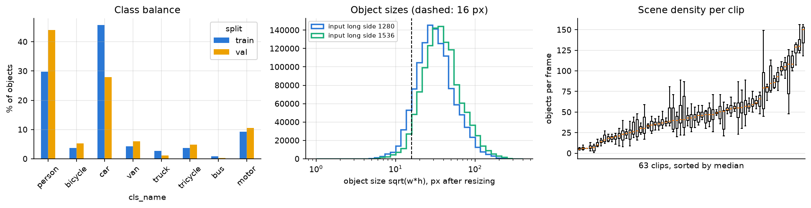
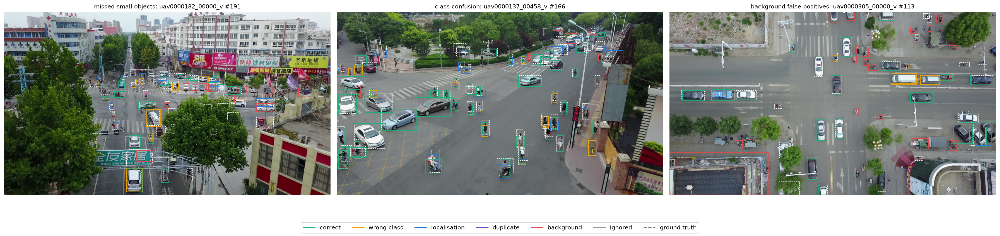
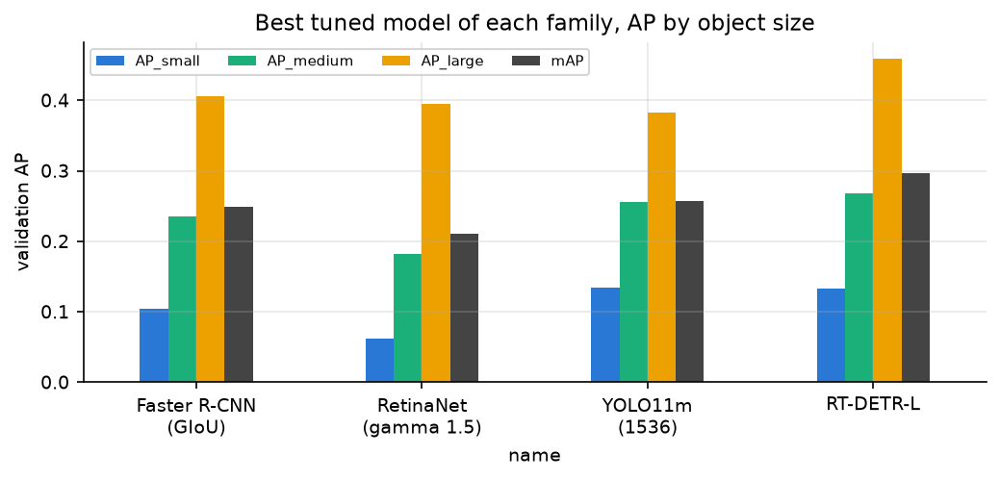
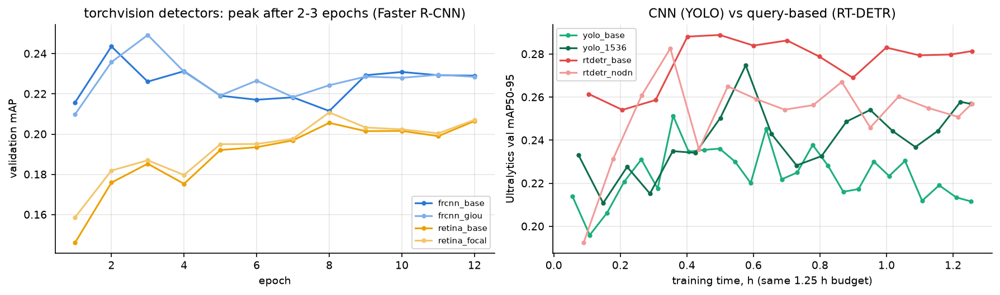
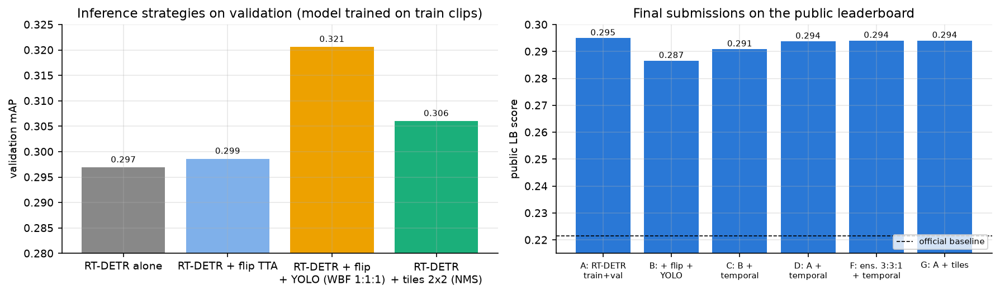
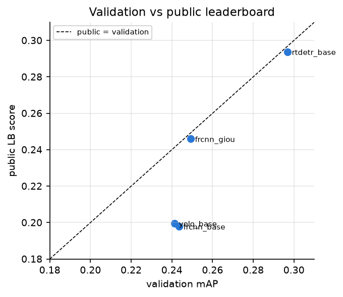

## Data

The task was to find people and vehicles in drone videos. A few things in the data shaped the whole project. Classes are very unbalanced: cars are almost half of all objects, while buses are rare. Objects are tiny, and if we shrink the frame too much, many of them almost disappear. So we trained all models at 1280 px, which was also the limit of our 8 GB GPU. Scenes are crowded, often with dozens of objects in one frame.

The data is video, and neighbouring frames look almost the same, so we kept every 10th frame. Some areas are marked as ignored regions, crowds and parking lots too dense to label. We painted them grey in training images, so the model would not learn that tiny objects there are background.

## Validation

Because frames of one video are so similar, we split by video, not by frame. Otherwise validation would contain almost the same images as training. The 7 validation videos were our hold-out set, and we measured COCO mAP like on Kaggle, without punishing boxes in ignored regions. Every model got the same frames, input size, evaluation code and roughly the same training time. We checked the converted labels by drawing them on the frames.

## Faster R-CNN

We started with Faster R-CNN. Its first stage proposes candidate boxes, and the second decides what is inside and refines the box. The first stage already finds most objects. The second loses quite a few, especially small ones, because it has very little information about such tiny boxes.

Smaller anchors did not help, and the GIoU box loss was only slightly better, close to the noise between epochs.
All runs peaked after two or three epochs and then started to overfit, which shows we do not have many different
scenes.

Most mistakes were false boxes on the background and mixed-up classes. Far objects near the horizon were missed, cars, vans and trucks look alike from above, and some "false" boxes were real objects without labels.

## RetinaNet

RetinaNet predicts boxes directly from a dense grid of anchors. The default anchors were too big for many small objects. Smaller ones helped small objects a bit but hurt bigger ones, and changing the focal loss did not change much. RetinaNet was weaker than Faster R-CNN, although faster. Without a proposal stage it faces a huge number of anchors that are almost all background.

## YOLO11

YOLO11 has no anchors. Each object is learned from the grid points inside it, and a tiny object has only a few.
Still, YOLO was the best CNN on small objects and the fastest. A larger input helped it most. An extra high-resolution layer did worse, because its new layers start from scratch and our training time was too short.

## RT-DETR

RT-DETR is a transformer detector that matches every object to exactly one query, so it needs no NMS. With the same training time it was clearly the best, about 4 points above the best CNN, but slower and not better on the smallest objects. It also trained more calmly than YOLO. Without denoising its curve became jumpy, and more queries helped only in the most crowded video.
On our GPU one frame takes about 45 ms for Faster R-CNN, 29 ms for RetinaNet, 27 to 34 ms for YOLO and 68 ms for RT-DETR.

## Our pipeline

We kept RT-DETR and tried improvements one at a time. Flipping at test time did almost nothing. Combining it with YOLO looked very good on validation. Cutting frames into four tiles helped small objects, since a tiny car becomes two or three times bigger. Without grey masks small objects got clearly worse, and twice more frames did not help, so we lack scenes, not frames. That is why the final model was trained on all labelled videos.

For the bonus, we trusted a box more if it also appears in neighbouring frames. This helped the ensemble a little,
on validation and on Kaggle, but did almost nothing for RT-DETR alone.

The biggest lesson came from the leaderboard. The RT-DETR and YOLO ensemble, which was the best on validation, did worse on Kaggle than RT-DETR alone. YOLO had already shown a big drop from validation to the test set before, while RT-DETR had not. Our best guess is that many test videos have low resolution, and our validation videos do not. So our validation simply could not see this problem.

## Final model and how to run

We chose two final submissions. One is RT-DETR with tiles, the best on validation among the options without YOLO. The other is plain RT-DETR, the simplest and safest option, which also had the best public score of about 0.295, well above the baseline. The final model is RT-DETR-L trained on all labelled videos. At test time it looks at the full frame and at four tiles, and the boxes are merged together. To reproduce it, install the packages from `requirements.txt`, add a Kaggle token and run the notebooks in order, from `01_data` to `06_final`. All settings, seeds and versions are described in [INSTRUCTIONS.md](INSTRUCTIONS.md), and the exact numbers for every experiment are saved in `results/`.

## Conclusions

The transformer-based RT-DETR worked best for the same amount of compute, while the CNN models were faster. Small objects stayed the hardest part for every model. If we did it again, we would add low-resolution frames to our validation set, so that it looks more like the real test data.

## Summary of results

Validation mAP is measured on the same 420 frames from the 7 held-out videos for every run. Public score is shown for the runs we submitted to Kaggle. For the last three rows the public score comes from the final models trained on all videos, so there is no validation score for the final model itself.

| Model or step | Val mAP | Val AP small | Public |
|---|---|---|---|
| Faster R-CNN, baseline | 0.244 | 0.101 | 0.198 |
| Faster R-CNN, smaller anchors | 0.237 | 0.100 | |
| Faster R-CNN, GIoU loss | 0.249 | 0.104 | 0.246 |
| RetinaNet, baseline | 0.207 | 0.072 | |
| RetinaNet, smaller anchors | 0.187 | 0.074 | |
| RetinaNet, focal gamma 1.5 | 0.211 | 0.061 | |
| YOLO11m, 1280 | 0.241 | 0.133 | 0.200 |
| YOLO11m, 1536 | 0.257 | 0.134 | |
| YOLO11m, extra P2 head | 0.222 | 0.113 | |
| RT-DETR-L, baseline | 0.297 | 0.133 | 0.294 |
| RT-DETR-L, 500 queries | 0.286 | 0.122 | |
| RT-DETR-L, no denoising | 0.290 | 0.136 | |
| RT-DETR-L, no masking | 0.298 | 0.095 | |
| RT-DETR-L, every 5th frame | 0.283 | 0.113 | |
| RT-DETR + flip TTA | 0.299 | 0.126 | |
| RT-DETR + flip + YOLO ensemble | 0.321 | 0.144 | 0.287 |
| RT-DETR + tiles | 0.306 | 0.165 | 0.294 |
| Final RT-DETR on all videos | | | 0.295 |

## References

We used ideas from Faster R-CNN, FPN, RetinaNet, GIoU, YOLOv2, ATSS, TOOD, DETR, DN-DETR, RT-DETR, WBF, SAHI, Seq-NMS, TIDE and the VisDrone paper. The code is based on torchvision, Ultralytics, pycocotools and
ensemble-boxes. Parts of the code were written with the help of an AI assistant. We ran, checked and understand all of it.